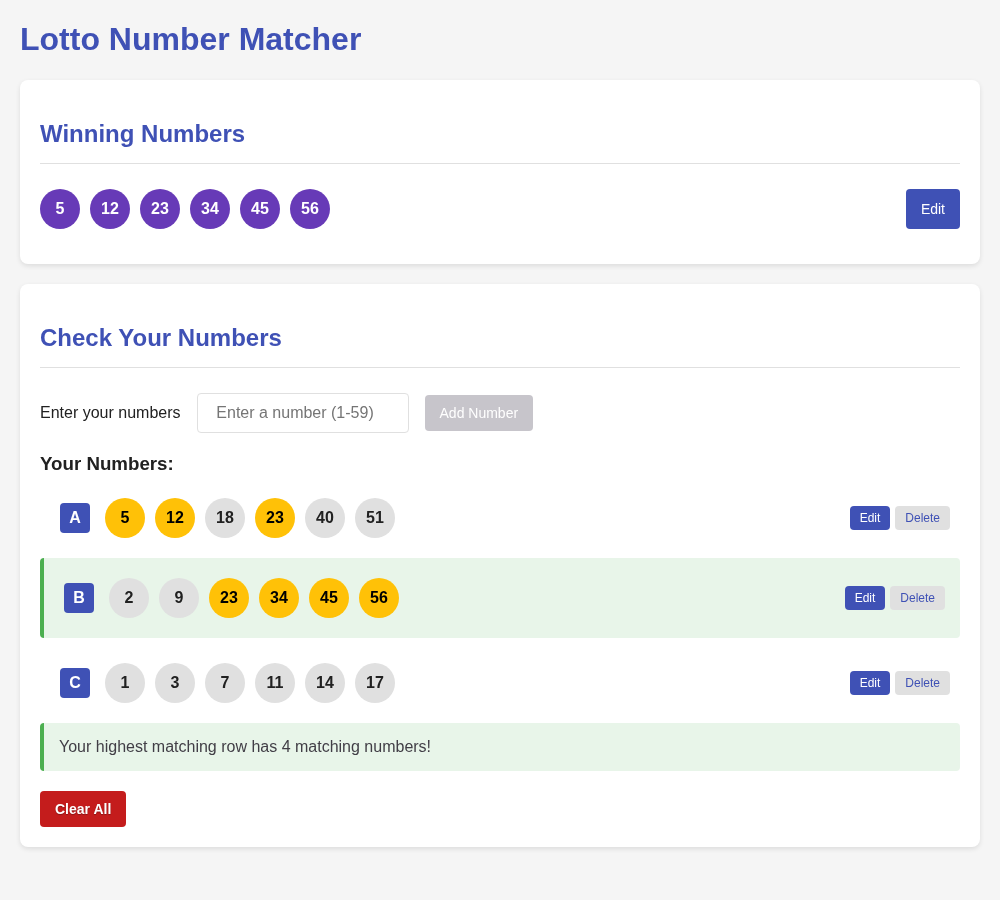

# Lotto Number Checker

Check rows of lotto numbers against a draw's winning numbers. Matching numbers are highlighted and the row with the most matches stands out.

https://lotto.app.rgpl.xyz



Enter the six winning numbers, then add your numbers one at a time; they fill rows of six. Rows can be edited or deleted. Numbers go from 1 to 59, which covers the PCSO 6/42, 6/45, 6/49, 6/55 and 6/58 games.

Not affiliated with PCSO. Check real results through PCSO's own channels.

## Running it

Node 22.22.3+ or 24.15+, see `.nvmrc`.

```bash
npm ci
npm start    # http://localhost:4200
```

```bash
npx ng test --watch=false   # unit tests, Vitest
npx ng build                # dist/lotto/browser
```

## Live results (local only)

Under `ng serve` the app can also fetch recent results from pcso.gov.ph and fill in the winning numbers for you. That goes through the dev-server proxy in `proxy.conf.json`, which a production build doesn't have, so it's behind a build-time flag:

- `liveResults` is `true` in `src/environments/environment.development.ts` (used by `ng serve`) and `false` in `src/environments/environment.ts` (used by `ng build` and `ng test`).
- With the flag off the "Use Search Results" toggle isn't rendered and nothing contacts PCSO.
- The tests cover both values through the `FEATURE_FLAGS` token in `src/app/feature-flags.ts`.

Since October 2026 pcso.gov.ph answers the proxy with 403, so expect the error message and the Try Again button.

## Deploying

Static build served by nginx on the rgpl VPS. CI runs the tests and the build on every push. Deploys are manual: [deploy/README.md](deploy/README.md).

## License

GPL-3.0, see [LICENSE](LICENSE).
